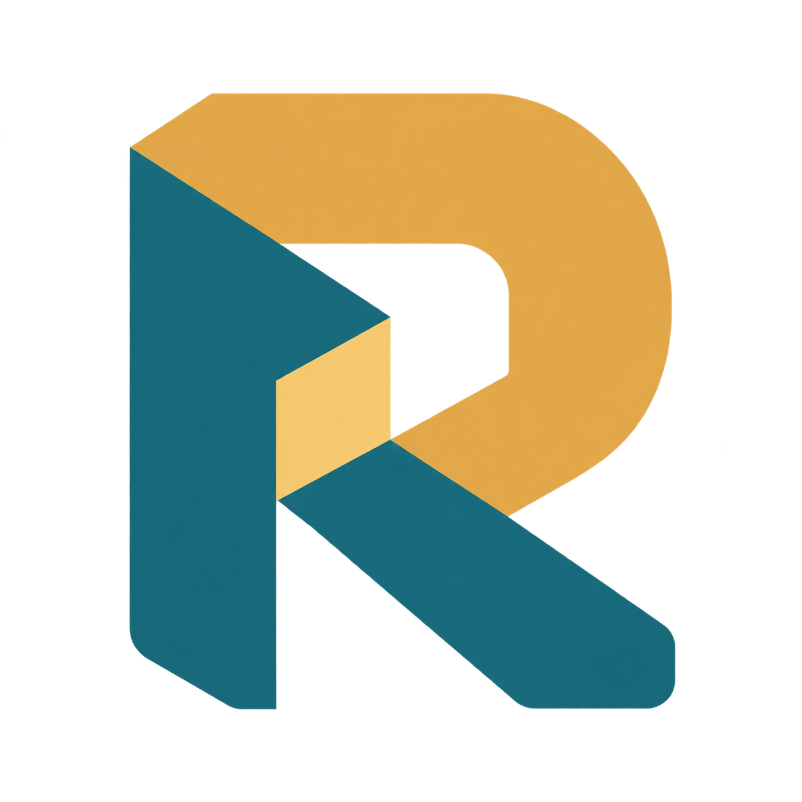
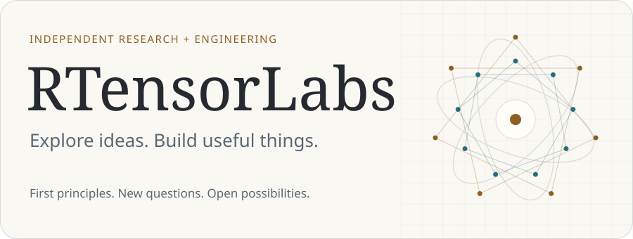
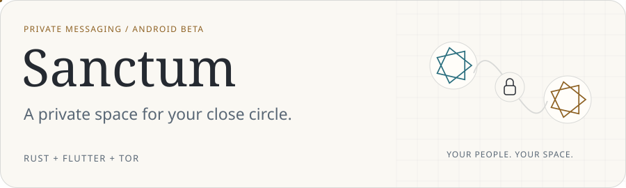
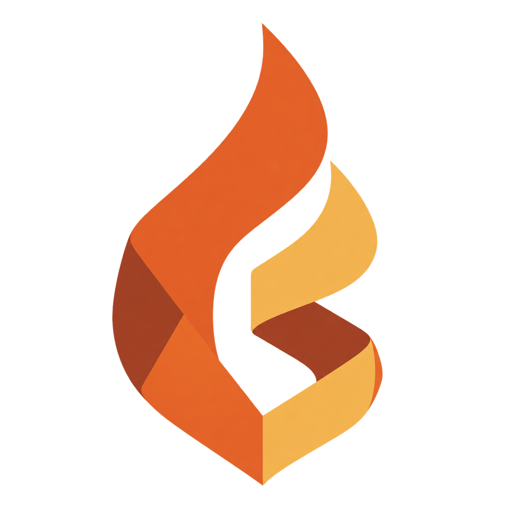
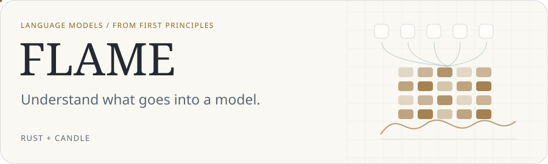
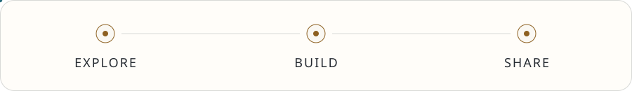

<picture>
  <source media="(prefers-reduced-motion: reduce) and (prefers-color-scheme: dark)" srcset="./assets/lab-v2-still-dark.svg">
  <source media="(prefers-reduced-motion: reduce)" srcset="./assets/lab-v2-still-light.svg">
  <source media="(prefers-color-scheme: dark)" srcset="./assets/lab-v2-dark.svg">
  
</picture>

**Independent research. Thoughtful engineering. Ideas made real.**

RTensorLabs is an independent research and engineering lab maintained by
[Tejas Gowda S](https://github.com/Tejascodex001).
We explore how things work, build from first principles, and turn experiments
into useful software.

AI, systems engineering, and privacy are some of our current interests.
They are starting points, not boundaries: future projects will follow interesting
questions and problems worth solving, across different fields.

## What we're building

### Sanctum

<a href="https://sanctum-rtensorlabs.vercel.app/">
<picture>
  <source media="(prefers-reduced-motion: reduce) and (prefers-color-scheme: dark)" srcset="./assets/sanctum-v2-still-dark.svg">
  <source media="(prefers-reduced-motion: reduce)" srcset="./assets/sanctum-v2-still-light.svg">
  <source media="(prefers-color-scheme: dark)" srcset="./assets/sanctum-v2-dark.svg">
  
</picture>
</a>

Private messaging for a close circle of friends. An Android app with end-to-end
encrypted chats, calls, and shared plans, using Tor by default. Conversations live
on the phones, with no central message server or account signup.

[Website](https://sanctum-rtensorlabs.vercel.app/) ·
[Source](https://github.com/RTensorLabs/sanctum) ·
[Download the Android beta](https://github.com/RTensorLabs/sanctum/releases/latest)

<h3> FLAME</h3>

<a href="https://learn-rust-flame-site.vercel.app/">
<picture>
  <source media="(prefers-reduced-motion: reduce) and (prefers-color-scheme: dark)" srcset="./assets/flame-v2-still-dark.svg">
  <source media="(prefers-reduced-motion: reduce)" srcset="./assets/flame-v2-still-light.svg">
  <source media="(prefers-color-scheme: dark)" srcset="./assets/flame-v2-dark.svg">
  
</picture>
</a>

A Rust framework for exploring language-model training from first principles,
built with Candle. Its learning resources and interactive visualizer make the
ideas behind a language model easier to inspect.

[Explore FLAME](https://learn-rust-flame-site.vercel.app/) ·
[Open the visualizer](https://huggingface.co/spaces/Tejascodex001/flame-visualizer)

## How we work

<picture>
  <source media="(prefers-reduced-motion: reduce) and (prefers-color-scheme: dark)" srcset="./assets/process-v2-still-dark.svg">
  <source media="(prefers-reduced-motion: reduce)" srcset="./assets/process-v2-still-light.svg">
  <source media="(prefers-color-scheme: dark)" srcset="./assets/process-v2-dark.svg">
  
</picture>

- **Understand the foundations.** Build and inspect the pieces behind the abstractions.
- **Make the trade-offs clear.** Explain what a project does, what it needs, and its limits.
- **Build with care.** Value privacy, useful interfaces, and software people can understand.
- **Keep exploring.** Let the problem guide the tools and the next project.

## Follow along

Browse our [public repositories](https://github.com/orgs/RTensorLabs/repositories),
try the projects, and use the relevant repository's issues for bugs and ideas.

[Meet the maintainer](https://github.com/Tejascodex001)
